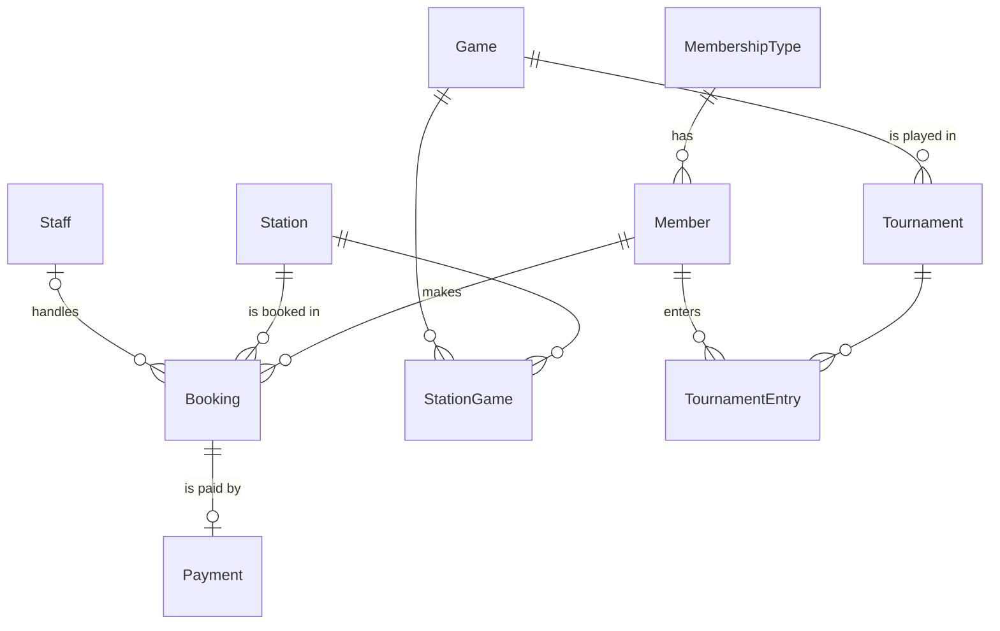

# GameZone Database

A relational database for a gaming lounge. Members book gaming stations (PC, console, VIP, VR, streaming),
pay for sessions and enter tournaments. The script builds the schema, loads sample data, runs analytical
queries and performs data-maintenance updates.

**Stack:** MySQL 8.0.16+ / MariaDB 10.4+

## Run it

```bash
mysql -u root -p < GameZone.sql
```

The script drops and recreates the `GameZone` database each time, so it can be re-run safely.
Reports use the `@ReportYear` variable (set to 2025 to match the sample data) at the top of the file.

## Schema



| Table | Purpose |
| --- | --- |
| `MembershipType` | Plans (Basic, Pro, Elite, Day Pass) with monthly fee and included hours |
| `Member` | Customers, each on one membership plan |
| `Staff` | Employees who handle bookings |
| `Station` | Bookable gaming stations with an hourly rate |
| `Game` | Game catalogue |
| `StationGame` | Many-to-many: which games are installed on which station |
| `Booking` | A member's session at a station (Scheduled / Completed / Cancelled) |
| `Payment` | One payment per booking |
| `Tournament` | Tournaments for a game, with prize pool and capacity |
| `TournamentEntry` | Member registrations and placements (one entry per member per tournament) |

Integrity is enforced with primary, foreign and composite keys, `UNIQUE` constraints, and `CHECK` constraints
(valid status values, non-negative amounts, end time after start time, tournament end date on or after start date).

## Queries

| # | Question answered | Techniques |
| --- | --- | --- |
| Q1 | Completed VIP sessions, most expensive first | Multi-table `JOIN` |
| Q2 | Tournament players with a phone number and no cancelled bookings | `EXISTS` / `NOT EXISTS` |
| Q3 | Booking revenue vs. prize payouts and net result for the year | Derived tables, `CROSS JOIN`, `COALESCE` |
| Q4 | Upcoming scheduled bookings | `JOIN`, filtering |
| Q5 | Paid revenue and session count by station type | `GROUP BY`, aggregates |
| Q6 | Tournament results with game titles, unplaced entries last | Four-table `JOIN`, `NULL`-aware ordering |
| Q7 | Completed sessions, newest first | Subquery in `FROM` |
| M1 | Upgrade members who have paid over AED 400 to Elite | `UPDATE` with grouped subquery and `HAVING` |
| M2 | Remove unplaced entries from finished tournaments | `DELETE` with subquery |

M1 and M2 are each followed by a check query that shows their effect.
