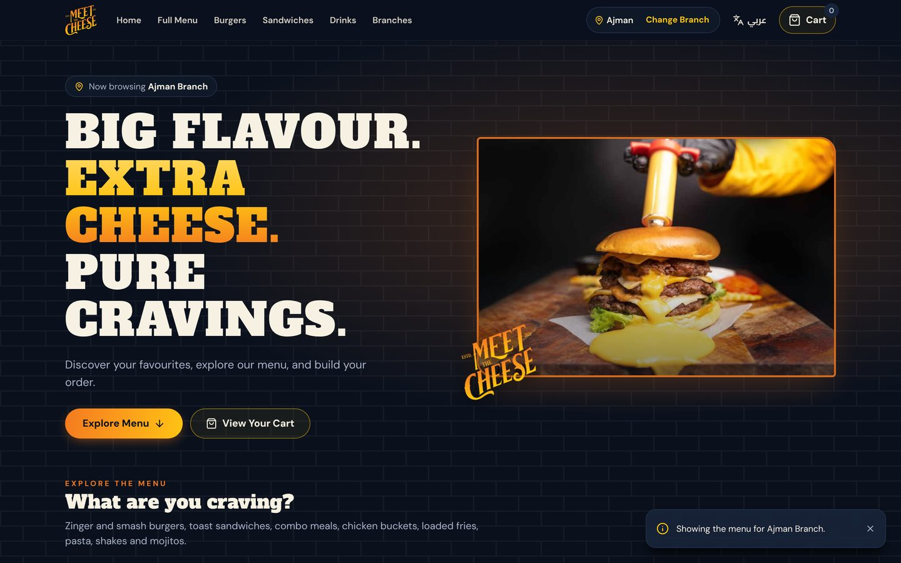
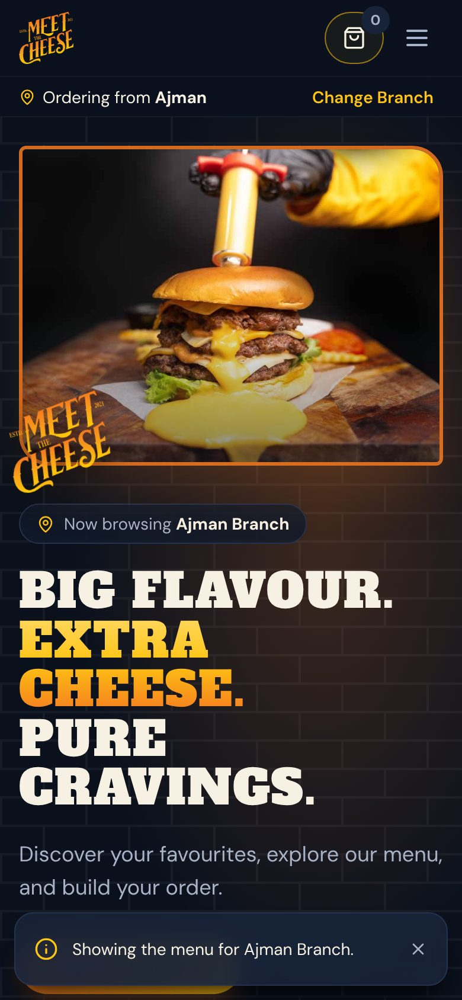
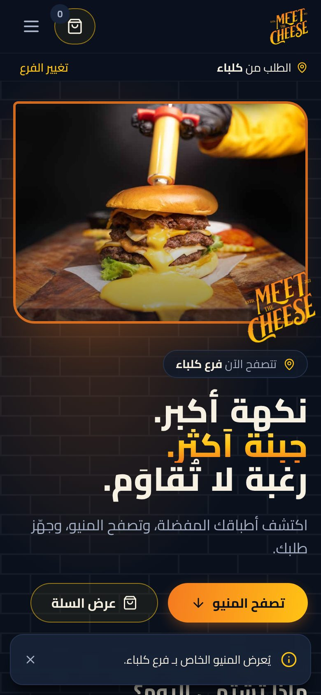

# Meet The Cheese — Restaurant Ordering Website

A bilingual (English / Arabic) online menu and WhatsApp ordering site built for **Meet The Cheese**, a burger restaurant
with branches in Ajman, Al Zubair and Kalba (UAE). Customers pick a branch, browse 138 menu items, build a cart and send
the finished order straight to that branch on WhatsApp.

**Stack:** React 18 · TypeScript · Vite 6 · Tailwind CSS 4 · Vitest — static site, ready for Netlify / Vercel.

| Desktop | Mobile | Arabic (RTL) |
| --- | --- | --- |
|  |  |  |

### Highlights
- **Branch-aware cart:** a cart never mixes branches; switching branch with items in the cart asks before clearing it. Cart, branch and language persist in `localStorage`.
- **WhatsApp order flow:** builds a formatted order message (items, options, quantities, line totals, subtotal) and opens WhatsApp to the selected branch, with a copy-and-paste fallback if the pop-up is blocked.
- **Full English / Arabic support** with a complete right-to-left layout, switchable at any time.
- **QR-code deep links** (`?branch=kalba&lang=ar`) that open the menu with a branch and language preselected.
- **Accessibility:** keyboard navigation, skip link, focus trapping and restoration in dialogs, live-region announcements, reduced-motion support.
- **Reliability:** page- and app-level error boundaries, prices always read from source data (stale stored prices are ignored).
- **34 automated tests** covering cart maths, the WhatsApp message, branch links, menu data integrity and translation completeness.

---

## Quick start

Requires **Node.js 20 or newer** (developed and tested with Node 24 LTS).

```bash
npm install
npm run dev
```

The development server runs at **http://localhost:5173**.

| Command | What it does |
| --- | --- |
| `npm run dev` | Development server with live reload (http://localhost:5173) |
| `npm test` | Automated tests: cart maths, WhatsApp message, branch links, menu data, translations |
| `npm run typecheck` | TypeScript checks |
| `npm run build` | Type-check and build the production site into `dist/` |
| `npm run build:demo` | Build a **preview** for sharing before launch: adds a "Preview" banner and a no-index tag (see docs/DEPLOYMENT.md) |
| `npm run preview` | Serve the built `dist/` folder locally (http://localhost:4173) to check the production build |

**Windows shortcut:** double-click **`Start Website.bat`**. It checks that Node.js and the dependencies are present, then runs
`npm run dev` and tells you which address to open (normally http://localhost:5173). It never installs anything; if dependencies
are missing it asks you to run `npm install` first. Close the window (or press Ctrl+C) to stop.

Opening `index.html` directly from the folder does not work. The site must be served by `npm run dev`, `npm run preview` or a web host.

---

## What the website does

**Implemented**
- First-visit branch picker for Ajman, Al Zubair and Kalba. The choice is remembered, shown in the header, and can be changed at any time.
- A cart never mixes branches. Switching branch with items in the cart asks for confirmation before clearing it.
- Full menu: 138 items in 21 categories with 109 product photos taken from the official menus, plus category filters and search (English names; Arabic category words also work).
- Price options (Single / Meal and other printed price pairs), with uncertain prices clearly flagged. Items whose price can't be read can't be added to the cart; they show an "Ask price" WhatsApp button instead.
- Cart drawer: change quantities, remove (with undo), clear (with confirmation), subtotal. Saved on the device across refreshes.
- Order summary with a three-step explanation (review → send on WhatsApp → branch confirms).
- **WhatsApp order request:** opens WhatsApp to the selected branch's number with the full order typed in (items, options, quantities, unit prices, line totals, subtotal). The customer reviews and presses Send. If a pop-up blocker stops WhatsApp from opening, a fallback shows the link and the full message to copy.
- English and Arabic interface with full right-to-left layout. The choice is remembered.
- Branch-specific links for QR codes (`?branch=ajman`), with optional `&lang=ar`.
- Homepage: hero, category introduction, menu highlights, full menu, all three branches with Call / WhatsApp links, footer, privacy notice and a branded "page not found".
- SEO basics: title, description, social-sharing image, favicon/app icon, robots.txt, and a sitemap plus canonical URL once the domain is set.
- Accessibility: keyboard navigation, skip link, focus moved into dialogs and back out, focus trapping (notifications such as "Undo" stay reachable),
  Escape closes the top-most dialog only, screen-reader labels and live notifications, focus moved to the new page after navigation,
  visible focus, and reduced-motion support (including scripted scrolling).
- Error handling: if a part of the page crashes unexpectedly, a friendly message with "Reload" / "Back to Home" appears instead of a blank
  page (English or Arabic). The real error is still logged to the browser console.

**Not implemented (by design)**
- No online payments, no delivery address or delivery checkout, no customer accounts.
- No automatic order submission: the site never sends anything to the restaurant. Orders reach a branch only when the customer presses Send in WhatsApp, and the branch confirms by replying.
- No admin dashboard. Menu, prices and branch details are edited in code (see below).
- No analytics or tracking scripts.
- Product names are not translated into Arabic. They stay exactly as printed on the menu.

---

## Updating content

### Menu items and prices — `src/data/menu.ts`
Each category has a table of rows: `[id, name, price]`.

```ts
['classic-zinger', 'Classic Zinger', meal(21, 29)],   // two prices: Single 21 / Meal 29
['lotus-shake', 'Lotus Shake', 14],                   // one price
['potato-wedges', 'Potato Wedges', two(8, 12)],       // two prices, meaning unconfirmed (flagged)
['sauce-spicy', 'Spicy Sauce', null, null],           // price unknown → cannot be ordered
```

- **Change a price:** edit the number(s).
- **Confirm an uncertain item:** once the restaurant confirms, replace `two(a, b)` with `meal(a, b)` or a single number, and replace `null` with the price. The warning badge disappears automatically.
- **Add an item:** add a row with a new, unique `id` (lowercase-with-dashes) to the right category.
- **Remove an item:** delete its row.
- **Menu highlights on the homepage:** edit `FEATURED_PRODUCT_IDS` at the bottom of the same file.
- Run `npm test` afterwards. It checks for duplicate ids, missing photos and invalid prices.

### Product photos — `public/images/menu/<id>.jpg`
Each photo is named after the product `id` (e.g. `classic-zinger.jpg`). To replace a photo, overwrite the file with a
square JPG (about 800×800 px, under ~150 KB). Add-ons and sauces have no photos on the printed menu and are shown as a price list.
Items that share a photo (the chicken and strip buckets) name it in the row's fourth value, e.g. `'chicken-bucket'`.

The current photos were extracted from the restaurant's PDF menus and are fairly low-resolution (about 270 px source),
so they can look slightly soft on high-resolution phone screens. **Original photos from the restaurant would be better**; drop them in
with the same file names. They are kept as JPG (≈24 KB each on average); converting to WebP/AVIF was not done because the gain is
small and would add an extra build step to maintain.

### Branch details — `src/data/branches.ts`
Address, phone numbers, which numbers accept WhatsApp, and opening hours (English and Arabic; one row per group of days, e.g. Sat – Thu / Friday).
- `display` is what customers see; `e164` is digits only including `971`, with no `+` or spaces (used for Call and WhatsApp links).
- WhatsApp orders go to numbers marked `whatsapp: true`.
- Opening hours currently come from each branch's Google listing and still need the restaurant's confirmation.
- Only add map links, addresses or numbers that the restaurant has confirmed. (+971 56 510 8828 was removed: it is not on WhatsApp.)

### Interface text — `src/i18n/en.ts` and `src/i18n/ar.ts`
All buttons, headings and messages in both languages. Every English key must exist in Arabic; `npm test` checks this.

---

## Branch links and QR codes

Each branch has its own link that opens the menu with that branch already selected:

| Branch | Link (replace `https://YOUR-DOMAIN` once the site is live) |
| --- | --- |
| Ajman | `https://YOUR-DOMAIN/?branch=ajman` |
| Al Zubair | `https://YOUR-DOMAIN/?branch=al-zubair` |
| Kalba | `https://YOUR-DOMAIN/?branch=kalba` |

- Add `&lang=ar` to open in Arabic, e.g. `https://YOUR-DOMAIN/?branch=kalba&lang=ar`.
- An unknown branch value is ignored. The customer sees a short notice and the normal branch picker.
- If the customer already has a cart for a different branch, they are asked before the cart is cleared.
- The link parameters are removed from the address bar after loading, so a later refresh keeps the customer's own choice.

**Creating the QR codes (after the site has a real domain):**
1. Open each final link in a phone browser and check that the right branch opens.
2. Generate a QR code for each link with any QR generator that produces a static QR code (no redirect/tracking service), as SVG or high-resolution PNG.
3. Scan each printed test copy with both an iPhone and an Android phone before printing in bulk.
4. Print at least 2.5 × 2.5 cm, with a quiet margin around the code, on a light background.

Do not generate QR codes for `localhost` addresses; they only work on this computer.

---

## Deployment

The production build is a folder of static files (`dist/`) that any static host can serve. Pages use `#/` addresses
(e.g. `/#/summary`), so refreshes and direct links work without special server rules. Fallback configs are included anyway:
`netlify.toml` (Netlify) and `vercel.json` (Vercel).

See **[docs/DEPLOYMENT.md](docs/DEPLOYMENT.md)** for step-by-step instructions (Netlify, Vercel, Cloudflare Pages),
connecting a domain, and the pre-launch checklist.

**`SITE_URL`:** set this environment variable to the live address (e.g. `https://www.example.ae`, no trailing slash) in the
hosting dashboard or in a local `.env.production` file before building. It adds the canonical URL, absolute share-image
URL and `sitemap.xml`. Without it the site still works; those extras are simply left out. See `.env.example`.

---

## Project structure

```
src/
  data/menu.ts           menu, prices, categories, featured items
  data/branches.ts       branch details
  i18n/                  English + Arabic text, language switching
  context/               branch, cart, menu filter and notification state
  utils/cart.ts          cart calculations
  utils/orderMessage.ts  WhatsApp order message + link
  utils/branchLink.ts    ?branch= links for QR codes
  hooks/useCssVarHeight  publishes the live header / menu-toolbar heights as CSS variables
                         (--header-h, --toolbar-h) used by the sticky menu bar and scroll positions
  components/ErrorBoundary.tsx  friendly fallback instead of a blank page
  components/, pages/    interface
public/images/           product photos, logo, icons, share image
docs/                    handover, proposal template, deployment, menu confirmation list, screenshots
```

## Version control
`.gitignore` excludes `node_modules`, `dist`, `.env*` (except `.env.example`) and local tool folders (including `.netlify/`).

## Data stored on the customer's device
Only in the browser's local storage: `mtc.branch.v1` (selected branch), `mtc.cart.v1` (product ids, options and quantities — prices
are always read from `menu.ts`), and `mtc.lang.v1` (language). Nothing is sent to a server. A privacy notice is at `/#/privacy`.

## Further documents
- [docs/CLIENT_HANDOVER.md](docs/CLIENT_HANDOVER.md): plain-language overview for the restaurant
- [docs/MENU_CONFIRMATION.md](docs/MENU_CONFIRMATION.md): items and details the restaurant needs to confirm
- [docs/PROPOSAL_TEMPLATE.md](docs/PROPOSAL_TEMPLATE.md): optional fixed-price proposal template
- [docs/DEPLOYMENT.md](docs/DEPLOYMENT.md): hosting, domain and launch checklist
